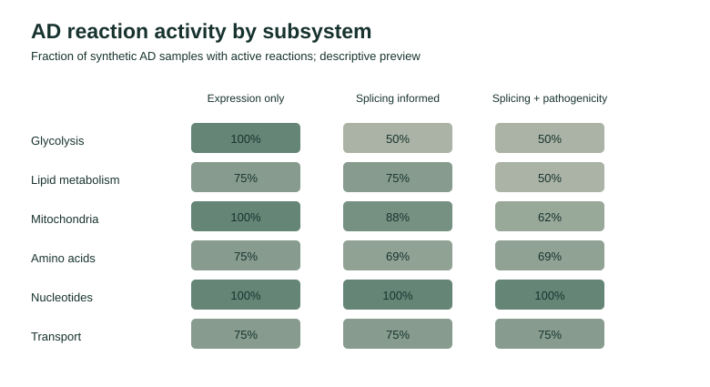
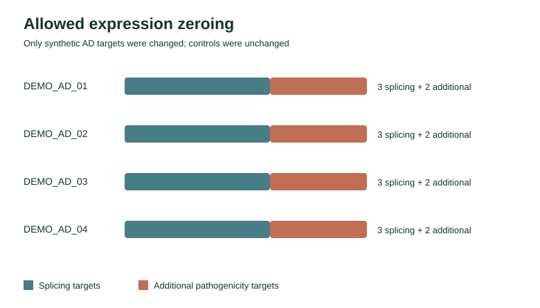

# Splicing and pathogenicity-informed iMAT workflow demo

A compact, **synthetic-data-only** demonstration of a three-layer reaction-activity
workflow. It separates a dependency-free visual preview from the full
Human-GEM / COBAMP / TROPPO iMAT pipeline, which requires a working Gurobi
installation and license. No patient or study cohort data are included.

## Explore the ready-made preview

[Open the HTML report](showcase/index.html) · [Browse the toy inputs](showcase/data/raw/) ·
[Inspect the zeroing audit](showcase/audits/zeroing.tsv) ·
[Read the generated summary](showcase/results/group_summary.tsv)


| Figure | What it shows |
| --- | --- |
| [Reaction counts](showcase/figures/active_reactions.svg) | AD and control means across three synthetic conditions |
| [Subsystem activity](showcase/figures/subsystem_activity.svg) | Descriptive activity fractions, not enrichment |
| [Zeroing audit](showcase/figures/zeroing_audit.svg) | AD-only splicing and additional pathogenicity targets |





The preview is deliberately **not an iMAT result**. Its invented gene values
are converted to illustrative reaction states with a simple threshold. It does
not use Human-GEM, COBAMP, TROPPO, Fisher testing, or reporter-like statistics.
It demonstrates the expected input schema, staged zeroing rules, audit trail,
result tables, figures, and HTML presentation without making biological claims.

### Regenerate the preview

Python 3.10 or newer and the standard library are enough:

```bash
python3 preview_demo.py
```

This deterministically rebuilds every file under `showcase/`. To write to a
different directory, use `python3 preview_demo.py --output /path/to/output`.
The same command can be run repeatedly. To check that the committed preview
matches the generator and that its links and invariants hold:

```bash
python3 -m unittest discover -s tests -v
```

If you open `showcase/index.html` directly and your browser blocks local file
links, serve the project directory with `python3 -m http.server 8000` and visit
`http://localhost:8000/showcase/`.

## Full Human-GEM workflow

The six numbered scripts run a distinct, model-based synthetic experiment on
the same 4 AD / 4 control **invented** samples:

1. Create synthetic expression, sample metadata, splicing targets, pathogenicity
   ranks, and reaction subsystem inputs from Human-GEM gene/reaction IDs.
2. Infer an expression-only reaction matrix with COBAMP GPR scoring and TROPPO
   iMAT.
3. Zero AD splicing targets, audit every change, and rerun iMAT.
4. Additionally zero AD targets with `pathogenicity_rank > 0.95`, audit the
   changes, and rerun iMAT. A rank of exactly `0.95` is not selected.
5. Save reaction-level Fisher results and 1,000-permutation reporter-like
   subsystem statistics with Benjamini-Hochberg adjusted p-values.
6. Produce PNG comparison figures from the calculated tables.

The full run requires Python 3.10, the pinned packages in `requirements.txt`,
and a licensed Gurobi installation. On a machine with those prerequisites:

```bash
python3.10 -m venv .venv
source .venv/bin/activate
python -m pip install -r requirements.txt
python download_model.py
python 00_create_synthetic_inputs.py
python 01_expression_only.py
python 02_splicing_informed.py
python 03_splicing_pathogenicity_informed.py
python 04_statistics_and_reporter_like.py
python 05_plot_results.py
```

`download_model.py` retrieves the version-pinned
[Human-GEM 1.12.0 SBML model](https://github.com/SysBioChalmers/Human-GEM/releases/tag/v1.12.0)
and checks its SHA-256 before placing it under `model/`. The 42 MB model is
excluded from this repository; its [CC BY 4.0 license](third_party_licenses/Human-GEM-CC-BY-4.0.md)
and [upstream attribution](model/README.md) are included. Cite the original
Human-GEM project when reusing the model.

The full pipeline writes `data/` and `results/` locally. Those directories are
ignored by Git. The GitHub-visible `showcase/` files are generated by the
independent, license-free preview, not by the full solver pipeline. The full
workflow saves binary **reaction-activity matrices**, not context-specific GEM
files. Its optimization and biological results are not exercised by the
lightweight GitHub check.

### Adapting inputs for an authorized dataset

Replace generated files under `data/raw/` only when you have permission to use
and share that dataset. Preserve these tab-separated schemas:

| File | Required columns |
| --- | --- |
| `expression.tsv` | `gene_id`, `biotype`, then one numeric column per sample |
| `metadata.tsv` | `sample_id`, `group` (`ad` or `control`) |
| `splicing_targets.tsv` | `sample_id`, `gene_id`, `gene_name` |
| `pathogenicity_ranks.tsv` | `gene_id`, `gene_symbol`, then one rank column per AD sample |
| `reaction_subsystem.tsv` | `reaction_id`, `subsystem` |

The same IDs must be used across expression, splicing, and pathogenicity files.
Gene IDs must match the Human-GEM model after version suffix removal. Only AD
sample values may be zeroed; the scripts stop if a control or unauthorized cell
changes. `00_create_synthetic_inputs.py --overwrite` **deletes and replaces**
the local `data/` directory, so do not use it after installing your own inputs.

## Scope and limitations

The preview is an educational visualization of a data contract, while the full
scripts are a solver-dependent research workflow. Neither is evidence of an
Alzheimer disease mechanism, biomarker, diagnosis, or treatment. Inspect sample
design, model assumptions, solver diagnostics, and multiple-testing limits
before adapting the full workflow to research data.
