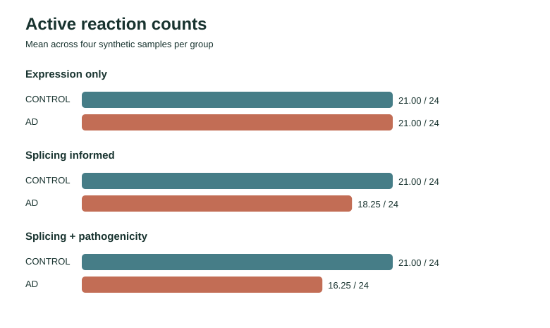
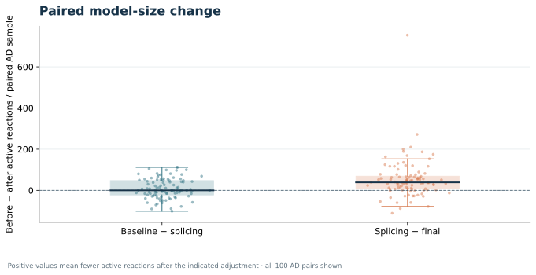
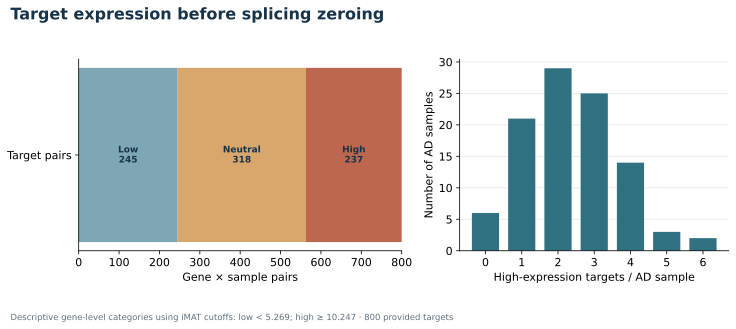
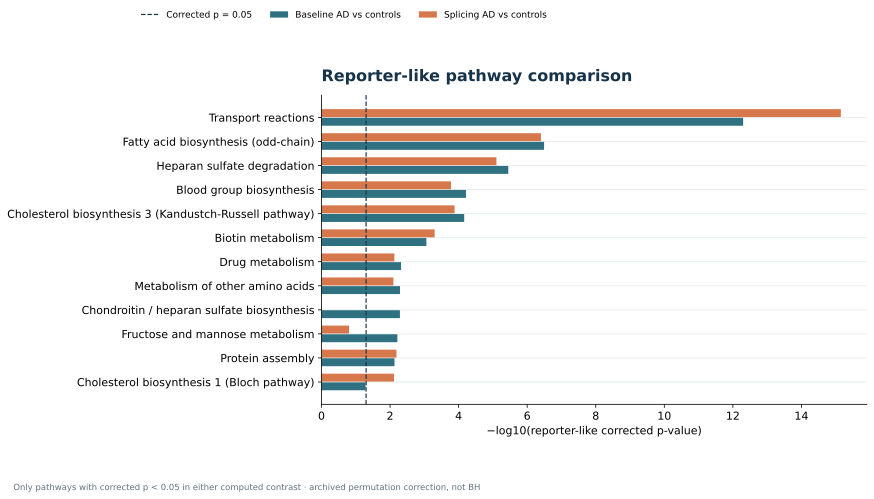

# Splicing and pathogenicity-informed iMAT | synthetic cohort

A reproducible, model-based workflow for exploring how staged expression changes
alter inferred reaction activity. The repository includes the supplied **synthetic**
100 AD / 100 control cohort, pinned Human-GEM 1.12.0 provenance, the complete
COBAMP → TROPPO iMAT → Fisher → reporter-like analysis code, and the results
and figures generated by that code.

> **Synthetic demonstration.** Sample labels are scenario labels, not patient
> diagnoses. These results must not be interpreted as Alzheimer disease biology,
> a biomarker, or evidence for a treatment.

## See the computed results

[Open the visual report](https://bioinformatikci.github.io/insights-from-biodata/projects/synthetic-imat/index.html) ·
[Browse result tables](showcase/results/) ·
[Inspect the supplied cohort](synthetic_single_cohort/README.md)

The visual report opens on the portfolio site. GitHub shows the source code of
HTML files; for offline viewing, download or clone this repository and open
`showcase/index.html` in a browser.
Every figure in `showcase/figures/` is generated from the committed iMAT matrices
and downstream statistics. The underlying reaction matrices, per-sample solver
diagnostics, reaction-level Fisher tables, and subsystem reporter-like tables
are available under `showcase/results/`.

### Figure gallery

**Reaction activity across the three inputs.** The control vectors are shown
once because their expression values do not change.



**Paired model-size changes.** Each dot represents one AD-labelled sample;
positive values mean fewer active reactions after the indicated adjustment.



**Targets before zeroing.** The chart uses the dataset's actual iMAT cutoffs and
the supplied splicing-target list. No complete splice-event call table was supplied.



**Reporter-like pathways.** Only computed pathways passing the archived method's
corrected p < 0.05 in either contrast are shown. If none pass, the figure says so.



## Analysis design

| Layer | Input to COBAMP GPR scoring and TROPPO iMAT |
| --- | --- |
| Expression only | Unmodified synthetic expression matrix |
| Splicing informed | Splicing-target expression set to zero in AD-labelled samples only |
| Splicing + pathogenicity informed | The preceding layer plus AD-only genes with pathogenicity rank strictly greater than 0.95 set to zero |

The same 200 synthetic samples and the same Human-GEM 1.12.0 model are used in
all three layers. Control expression is never changed. The scripts save an audit
of every requested zeroing operation and stop if any other cell changes.

For each layer, COBAMP combines gene expression through the model's GPR rules.
TROPPO iMAT solves each sample's mixed-integer optimization problem and records
a binary reaction-activity matrix; it does **not** export a context-specific
GEM. Reaction-level AD/control differences are tested with two-sided Fisher
exact tests. The archived R reporter-like method uses reactions with raw Fisher
p < 0.05, 1,000 permutations, and a permutation-normalized subsystem score.
Benjamini–Hochberg adjustment is supplied as an additional column for both
test families. These are computational contrasts of synthetic inputs,
not biological findings.
The archived reporter-like calculation is preserved; its local R copy also
writes a valid empty table when no Fisher reaction passes the raw threshold.

## Reproduce the run

Use Python 3.10, the pinned dependencies in `requirements.txt`, a working
Gurobi license, and `Rscript` for the archived reporter-like method. The
published matrices were computed with TROPPO iMAT through
COBAMP's **Gurobi** interface. The scripts explicitly select Gurobi by default;
COBRA's solver setting alone does not control COBAMP's solver.

```bash
python3.10 -m venv .venv
source .venv/bin/activate
python -m pip install -r requirements.txt
python download_model.py
python build_model_index.py --model model/Human-GEM-1.12.0.xml
python 00_prepare_cohort_inputs.py
python 01_expression_only.py
python 02_splicing_informed.py
python 03_splicing_pathogenicity_informed.py
python 04_statistics_and_reporter_like.py
python 05_plot_results.py
python 06_publish_showcase.py
```

To inspect statistics while the final iMAT layer is still running, use
`python 04_statistics_and_reporter_like.py --through splicing_informed`.
This writes Fisher and reporter-like tables for the first two layers and a
separately named partial summary. Run the command without `--through` after
all three matrices are complete to build the final comparison.

### Optional 50 + 50 AD processing for layers 2 and 3

After `01_expression_only.py` has completed, the next two layers can be run
with two independent Gurobi workers instead of their serial commands:

```bash
python parallel_imat.py splicing_informed --plan
python parallel_imat.py splicing_informed
python parallel_imat.py splicing_pathogenicity_informed --plan
python parallel_imat.py splicing_pathogenicity_informed
python 04_statistics_and_reporter_like.py
python 05_plot_results.py
python 06_publish_showcase.py
```

Each worker solves a disjoint 50-sample AD slice using the same COBAMP scorer,
TROPPO iMAT call, Human-GEM model, thresholds, and Gurobi solver as the serial
scripts. The runner checks checkpoint fingerprints, solver status, reaction
order, sample order, and unchanged controls before writing a complete 200-sample
matrix. Existing checkpoints allow rerunning after interruption. Two workers
need substantial RAM (the runner requires at least 14 GiB available) and a
Gurobi license that permits concurrent solves. If either condition is unmet,
use the serial commands above. The expression-only run is never split by this
runner.

The downloaded [Human-GEM 1.12.0 release](https://github.com/SysBioChalmers/Human-GEM/releases/tag/v1.12.0)
is checked against SHA-256
`53a74c4495ca4af1334ce67b74cc09fc1ab30c7648eef561f478cac2363f13ab`.
The supplied `reference/` folder contains an identical local model. The model
itself is omitted from Git because the repository already provides an official,
verified download; the compact `reference/model_index.tsv.gz` is committed for
traceable reaction-to-subsystem mappings. Human-GEM is attributed under
[CC BY 4.0](third_party_licenses/Human-GEM-CC-BY-4.0.md).

The supplied expression and pathogenicity tables are committed as `.tsv.gz`;
the preparation script expands them and checks their uncompressed SHA-256
digests against `synthetic_single_cohort/input_checksums.tsv`. `results/` is the
local working directory. Each successful iMAT sample gets a checkpoint there,
so an interrupted run can resume. The published `showcase/` is built solely
from completed results. Do not run `00_prepare_cohort_inputs.py --overwrite`
after placing other data in `data/`: that option replaces the local staged
input directory.

### If Gurobi is unavailable

To **recompute the published run**, install `gurobipy==11.0.3` and activate a
valid Gurobi license before starting the numbered scripts. If you only want to
inspect or replot the run, use the committed result matrices and tables; no
solver license is needed for that. An experimental fallback is available with
`IMAT_SOLVER=GLPK python 01_expression_only.py` (and the same prefix for layers
2 and 3) after installing GLPK and `swiglpk`. We tested that TROPPO can solve a
small GLPK example, **not** the full Human-GEM workload. GLPK can be much slower
and a different optimal solution can select a different reaction set. Do not
describe a GLPK run as a byte-for-byte reproduction of the Gurobi matrices.

### Reproducibility boundary

Input files, model version, library versions, thresholds, permutation seed, and
the committed outputs are pinned. The Fisher, reporter-like, figure, and HTML
steps are deterministic for a given reaction matrix. Mixed-integer models can
have multiple optimal flux solutions, so the exact binary reaction set may
vary across solver versions or platforms even when the objective is identical.
The committed Gurobi-derived matrices are the reference outputs for auditing
and redrawing the figures.

## Files and limitations

- `synthetic_single_cohort/`: supplied synthetic inputs and SHA-256 manifest.
- `reference/model_index.tsv.gz`: derived from the verified Human-GEM 1.12.0
  model, with reaction IDs, subsystem membership, and associated gene IDs.
- `00_prepare_cohort_inputs.py` through `06_publish_showcase.py`: ordered,
  rerunnable processing steps.
- `showcase/`: published computed outputs and an HTML report.

Fisher tests treat samples as independent synthetic units. The reporter-like
score is an illustrative permutation summary over model subsystems, not a
validated clinical or biological enrichment claim. The input README and
manifest describe how the supplied artificial cohort was constructed; those
provenance claims are based on the supplied files and are not independently
verified here.
